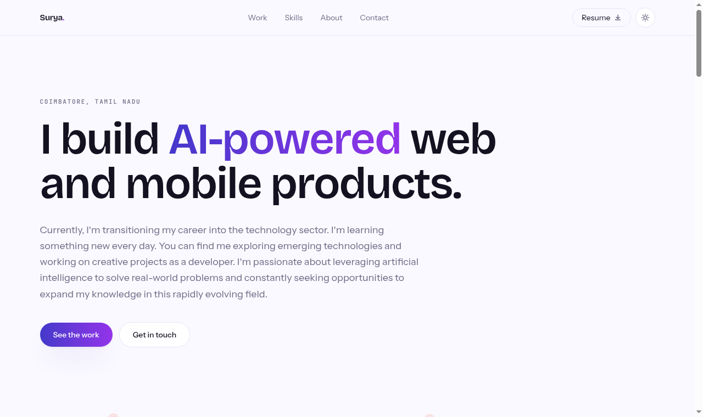

<div align="center">

# Surya Srekanth · Portfolio

**Full-stack, mobile and AI developer.**
A statically prerendered single-page portfolio built with Next.js 16 and Tailwind v4.

[**View live →**](https://suryasrekanth.vercel.app)




</div>

---

## Overview

A one-page portfolio covering work, skills, background and contact. Every route
is prerendered at build time, so the site is served as static files with no
server-side work per request.

The design is a light, product-focused theme with an indigo-to-violet accent and
a signature element drawn from the subject's own field: a **yarn evenness
trace**, the wavering readout an Uster tester prints when measuring yarn for
faults.

## Features

- **Content-driven.** All copy, projects, skills and links live in a single
  typed file. Component code is never edited to change text.
- **Dark mode.** Class-based, persisted to `localStorage`, and applied by a
  blocking inline script so there is no flash of the wrong theme on load.
- **Accessible.** WCAG AA contrast in both themes, visible keyboard focus, no
  horizontal overflow at 375px, and all motion disabled under
  `prefers-reduced-motion`.
- **Optimised images.** Project screenshots are served at the size each layout
  actually needs rather than at full resolution.
- **Generated metadata.** Favicon, Apple touch icon and Open Graph share card
  are produced from the App Router's file conventions.
- **Deterministic SVG.** The evenness trace is computed from fixed sine terms so
  server and client renders are byte-identical, avoiding hydration mismatches.

## Tech stack

| Layer | Choice |
| --- | --- |
| Framework | Next.js 16 (App Router) |
| UI | React 19 |
| Language | TypeScript 5 |
| Styling | Tailwind CSS v4, CSS custom properties for tokens |
| Fonts | Bricolage Grotesque, Instrument Sans, JetBrains Mono via `next/font` |
| Hosting | Vercel |

## Getting started

Requires **Node.js 20 or later**.

```bash
git clone https://github.com/SuryaSrekanth/portfolio.git
cd portfolio
npm install
npm run dev
```

The site runs at <http://localhost:3000>.

### Scripts

| Command | Purpose |
| --- | --- |
| `npm run dev` | Development server with hot reload |
| `npm run build` | Production build |
| `npm start` | Serve the production build locally |
| `npx tsc --noEmit` | Type check |
| `npx eslint .` | Lint |

## Project structure

```
src/
├── app/
│   ├── layout.tsx            root layout, fonts, metadata, theme script
│   ├── page.tsx              composes the page sections
│   ├── globals.css           design tokens and base styles
│   ├── icon.svg              favicon
│   ├── apple-icon.png        iOS home-screen icon
│   └── opengraph-image.png   social share card
├── components/               one file per section, plus shared pieces
└── content/
    └── site.ts               all site content
public/
├── projects/                 project screenshots
└── surya-srekanth-resume.pdf
docs/                         written guides, see below
```

## Editing content

Everything editable lives in **`src/content/site.ts`**:

| Export | Controls |
| --- | --- |
| `profile` | Name, headline, location, email, phone, links |
| `projects` | Project cards |
| `skillGroups` | Skill categories and chips |
| `experience` | Roles and bullet points |
| `education` | Qualifications |
| `about` | About paragraphs |
| `contact` | Contact heading and body |

### Adding a project

Append to the `projects` array:

```ts
{
  slug: "my-project",
  title: "My Project",
  summary: "One line on what it does for the person using it.",
  detail: "Two or three sentences on the problem and the build.",
  stack: ["Next.js", "FastAPI", "PostgreSQL"],
  kind: "web",          // "web" and "ai" render a browser frame, "mobile" a phone frame
  year: "2026",
  liveUrl: "https://example.com",
  image: "/projects/my-project.png",
  isLive: true,
}
```

Optional fields degrade gracefully. A project with no `image` falls back to a
composed abstract panel, and `draft: true` marks a card as unfinished with a
visible chip.

Capture screenshots at **1200x750** for the browser frame, or a **9:19** ratio
for the phone frame.

## Theming

Design tokens are CSS custom properties in `src/app/globals.css`, exposed to
Tailwind through `@theme inline`. Change a value once and it propagates
everywhere.

```css
:root {
  --paper:  #faf9ff;   /* page background       */
  --ink:    #141221;   /* primary text          */
  --indigo: #4338ca;   /* accent gradient start */
  --violet: #9333ea;   /* accent gradient end   */
  --signal: #ff6a4d;   /* live states and fault markers */
}
```

Dark mode redefines the same tokens under `.dark`, so components never
reference a raw colour value.

## Deployment

Deployed to Vercel from the project root:

```bash
vercel --prod
```

When changing the production URL, update `metadataBase` in
`src/app/layout.tsx`. It must point at a publicly reachable address, otherwise
social platforms cannot fetch the Open Graph image.

## Documentation

- **[docs/how-this-was-built.md](docs/how-this-was-built.md)** - the build
  decisions, the design system, and five real bugs with their causes and fixes.
- **[docs/web-foundations.html](docs/web-foundations.html)** - a standalone
  illustrated guide to the underlying tooling, for readers new to the stack.

## Contact

**Surya Srekanth** · Coimbatore, Tamil Nadu

[Email](mailto:suryasrekanth@gmail.com) ·
[WhatsApp](https://wa.me/919362651864) ·
[GitHub](https://github.com/SuryaSrekanth) ·
[LinkedIn](https://www.linkedin.com/in/surya-srekanth)

---

<sub>The source is published so the work can be reviewed. It is a personal
portfolio rather than a template, so no reuse licence is granted.</sub>
